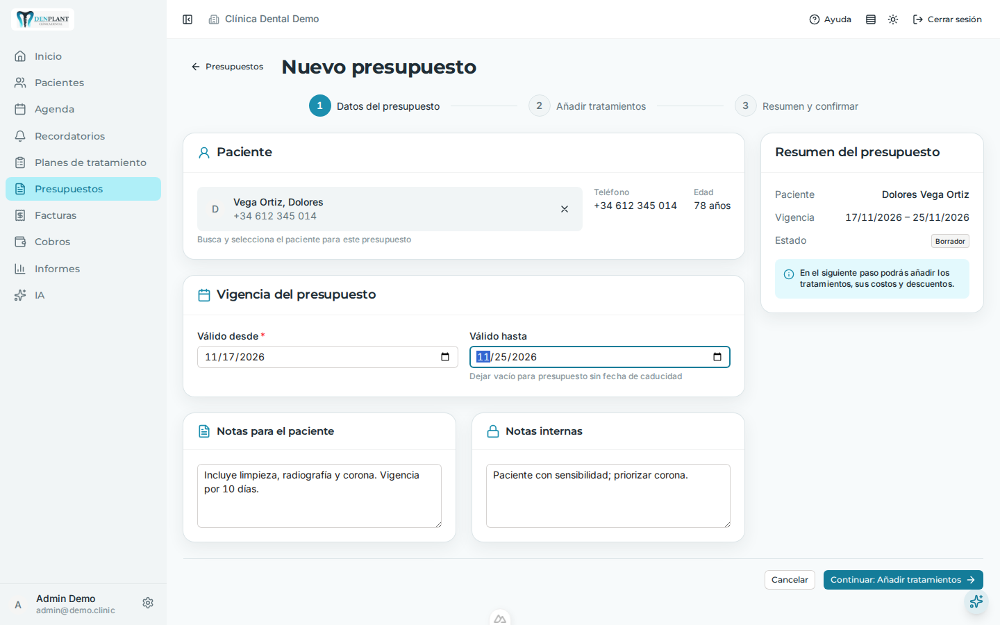
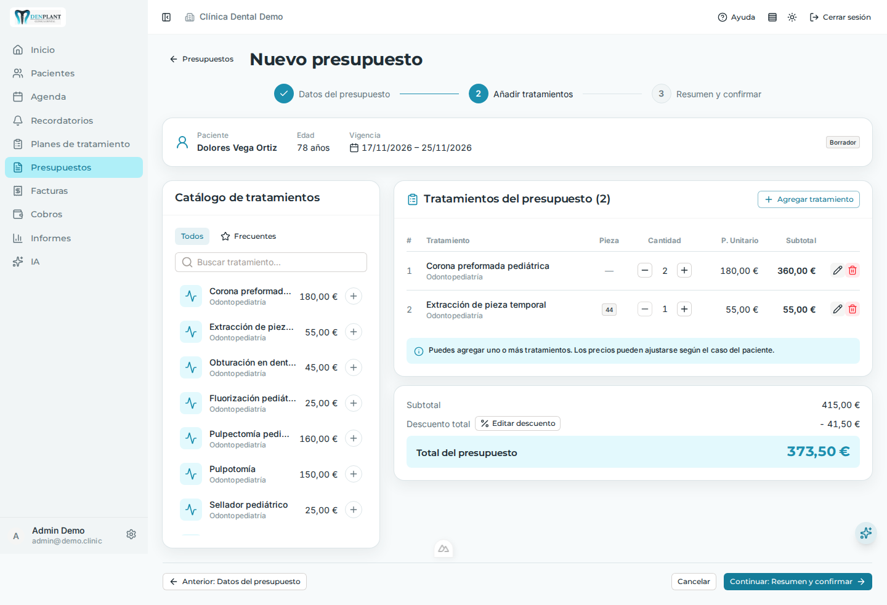
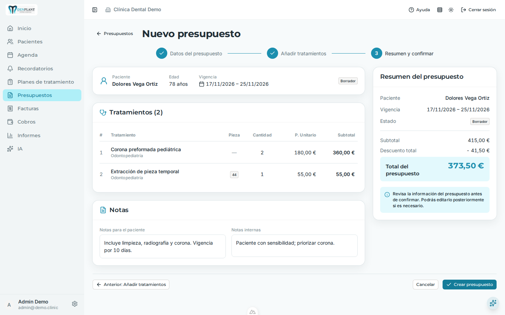

# New budget

Form to create a budget from scratch. The budget is born in `draft`
state on save, and the workflow continues from the
[detail](./budgets_id.md).

## At a glance

- **How you usually get here.**
  - From the patient record → *New budget* (patient pre-selected).
  - From the list → **New budget** (patient picker required).
  - From a treatment plan → generates a budget kept in sync via
    `treatment_plan.treatment_added` /
    `treatment_plan.budget_sync_requested` events.
- **Auto-numbering.** The number (`PRES-YYYY-####`) is assigned on
  save; it is not editable.
- **Default validity** — the form proposes `valid_from = today` and
  `valid_until = today + 30 days`. Adjust if your policy differs.
- **Price snapshot.** Each line records the catalog price effective
  at creation time. Editing the catalog later does not change
  existing budgets.

## Create a budget

> Requires `budget.write`.

The form is a 3-step wizard. Nothing is saved until the last step:
you can move back and forth without losing what you typed.

1. **Budget details.** Pick the patient (document, phone and age are
   shown when on file), the validity and the patient / internal
   notes.
2. **Add treatments.** Search the catalog (the *Frequent* tab lists
   the most used) and click **+** to add a line, or use **Add
   treatment** to set tooth, surfaces, quantity and line discount.
   From the table you can change the quantity, edit or remove each
   line and apply a global discount (percentage or absolute).
3. **Review and confirm.** Check patient, treatments, notes and
   totals, then click **Create budget**. A single `POST /budgets`
   request is sent with the lines and the global discount; the
   budget is created in `draft` and you land on the
   [detail](./budgets_id.md) to send it, sign it, or invoice it
   later.

The totals in steps 2 and 3 are a preview using the same formula as
the server; the final figures are the ones the backend computes on
creation.

## Create from a treatment plan

> Requires `budget.write` and `treatment_plan.write`.

1. On the treatment plan, click **Generate budget**.
2. The plan's treatments arrive in the form as prefilled lines via
   a snapshot event payload.
3. Adjust what you need and save.

## Permissions

| What you see / can do | Permission |
|-----------------------|------------|
| Access the form and see the catalog | `budget.read` |
| Create the budget | `budget.write` |

## Troubleshooting

- **Patient picker is empty.** You lack `patients.read` (without it
  the form cannot list patients).
- **A catalog item is missing.** Make sure it is active under
  *Settings → Catalog* and your role has `catalog.read`.
- **Totals don't match what you expect.** Check line vs global
  discount. Application order: price × quantity → line discount →
  VAT → global discount on the total.
