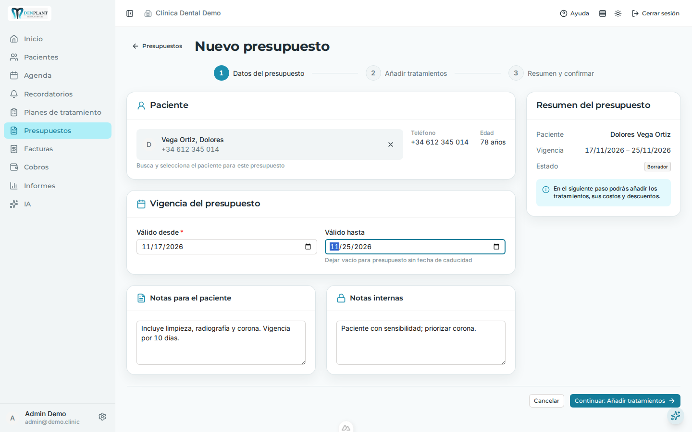
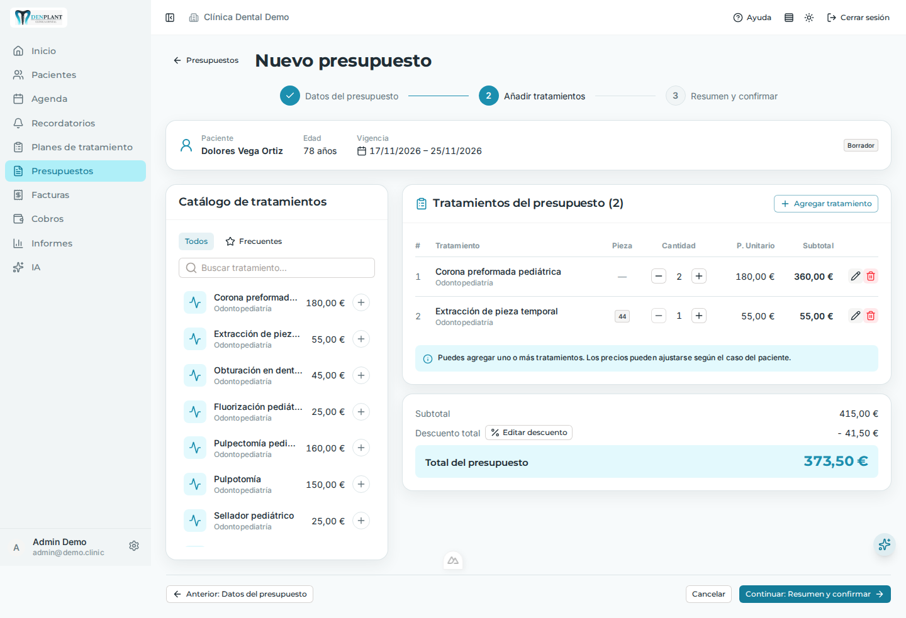
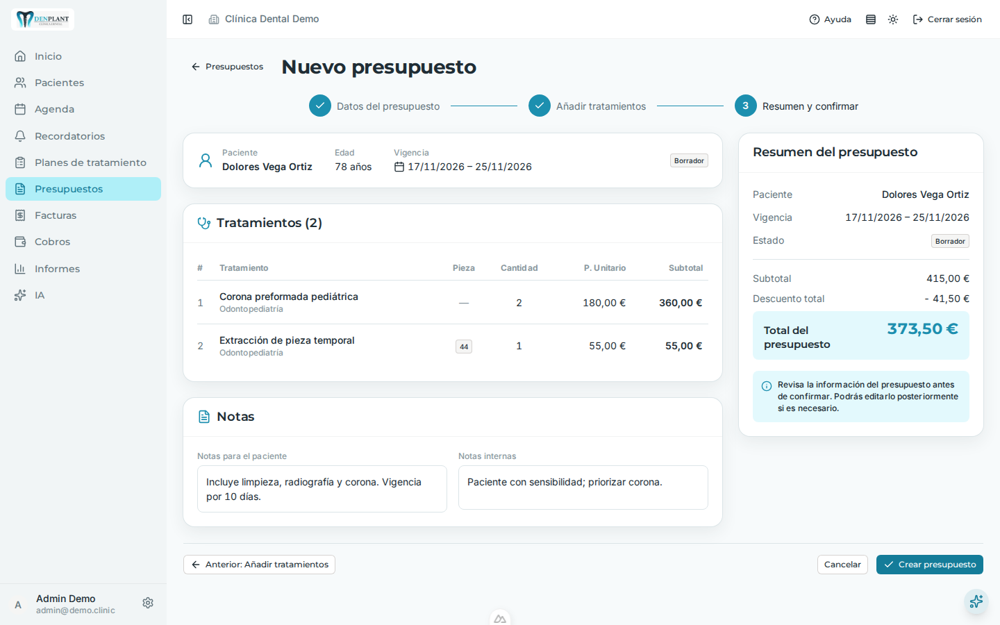

# Nuevo presupuesto

Formulario para crear un presupuesto desde cero. Al guardar nace en
estado `draft` y el flujo continúa desde el
[detalle](./budgets_id.md).

## De un vistazo

- **Origen del presupuesto.** Suele llegarse aquí desde:
  - La ficha del paciente → *Nuevo presupuesto* (paciente
    preseleccionado).
  - El listado → **Nuevo presupuesto** (selector de paciente
    obligatorio).
  - Un plan de tratamiento → genera un presupuesto sincronizado por
    eventos `treatment_plan.treatment_added` /
    `treatment_plan.budget_sync_requested`.
- **Numeración automática.** El número (`PRES-AAAA-####`) se asigna
  al guardar; no es editable.
- **Validez por defecto** — el formulario propone `valid_from = hoy`
  y `valid_until = hoy + 30 días`. Edítalo si vuestra política es
  otra.
- **Snapshot de precios.** Cada línea guarda el precio del catálogo
  vigente al crear el presupuesto. Cambiar el catálogo después no
  afecta a presupuestos existentes.

## Crear un presupuesto

> Requiere `budget.write`.

El formulario es un asistente de 3 pasos. Nada se guarda hasta el
último paso: puedes ir y volver entre pasos sin perder lo escrito.

1. **Datos del presupuesto.** Selecciona el paciente (se muestran
   su documento, teléfono y edad si constan), la vigencia y las
   notas para el paciente / internas.
2. **Añadir tratamientos.** Busca en el catálogo (pestaña
   *Frecuentes* con los más usados) y pulsa **+** para añadir una
   línea, o usa **Agregar tratamiento** para indicar pieza,
   superficies, cantidad y descuento de línea. Desde la tabla puedes
   cambiar la cantidad, editar o quitar cada línea y aplicar un
   descuento global (porcentaje o absoluto).
3. **Resumen y confirmar.** Revisa paciente, tratamientos, notas y
   totales y pulsa **Crear presupuesto**. Se envía una única
   petición `POST /budgets` con las líneas y el descuento global; el
   presupuesto nace en `draft` y te lleva al
   [detalle](./budgets_id.md) para enviarlo, firmarlo o facturarlo
   más tarde.

Los totales de los pasos 2 y 3 son una vista previa con la misma
fórmula que el servidor; las cifras definitivas son las que calcula
el backend al crear.

## Crear desde un plan de tratamiento

> Requiere `budget.write` y `treatment_plan.write`.

1. En el plan de tratamiento, pulsa **Generar presupuesto**.
2. Los tratamientos del plan llegan al formulario como líneas
   prerrellenadas mediante un evento snapshot.
3. Ajusta lo que necesites y guarda.

## Permisos

| Lo que ves / puedes hacer | Permiso |
|---------------------------|---------|
| Acceder al formulario y ver el catálogo | `budget.read` |
| Crear el presupuesto | `budget.write` |

## Resolución de problemas

- **El selector de paciente está vacío.** No tienes el permiso
  `patients.read` (sin él el formulario no puede listar pacientes).
- **No encuentro un ítem del catálogo.** Comprueba que esté activo en
  *Ajustes → Catálogo* y que tu rol tenga `catalog.read`.
- **El total no suma lo que espero.** Revisa el descuento por línea
  vs el global. Orden de aplicación: precio × cantidad → descuento
  línea → IVA → descuento global sobre el total.
